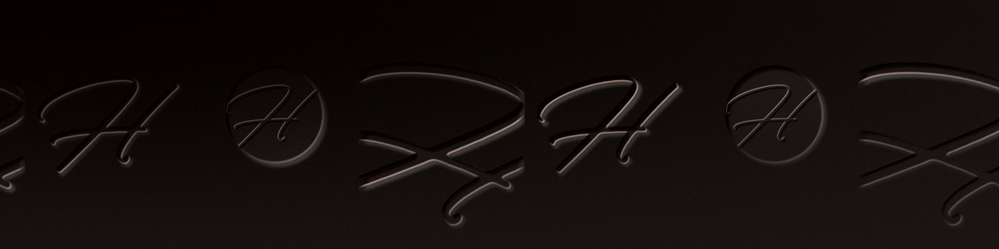

### Hi, I'm Haithem, a full stack engineer in Baghdad.

I build software that people in Iraq use every day: a bank's paperwork, a hospital's emergency room, a ride-hailing app, and an AI that answers shops' customer chats. Most of it is private, so the stories are on my site.

- [WFIS](https://madebyhaithem.com/projects/wfis): the bank's paper forms, moved online
- [Rdood](https://madebyhaithem.com/projects/rdood): an AI that answers shops' customer chats, in Iraqi Arabic
- [LST Hospital System](https://madebyhaithem.com/projects/lst): a hospital system built around the emergency room
- [TAN](https://madebyhaithem.com/projects/tan): a car marketplace built around short videos
- [Beeb](https://madebyhaithem.com/projects/beeb): ride-hailing and parcel delivery for Baghdad
- [AI News Auditor](https://madebyhaithem.com/projects/news-auditor): watches Iraqi TV news around the clock and flags what breaks the rules

[madebyhaithem.com](https://madebyhaithem.com) · [CV (PDF)](https://madebyhaithem.com/Haithem%20Mustafa%20CV.pdf) · [LinkedIn](https://www.linkedin.com/in/haithem-mustafa-dev/) · [The site's code](https://github.com/Haithem0161/madebyhaithem.com) · [haithem.m.nadhir@gmail.com](mailto:haithem.m.nadhir@gmail.com)
